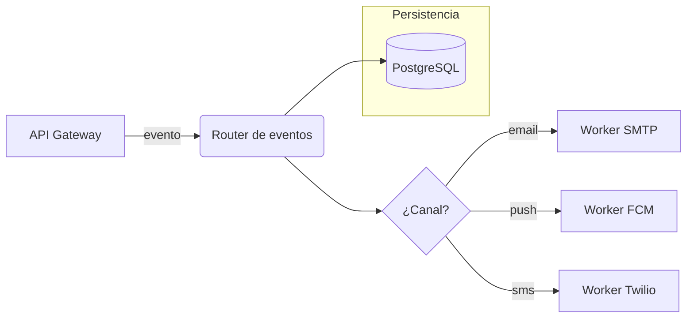

# Arquitectura del motor de notificaciones

El sistema recibe eventos de dominio y los entrega por canal según las preferencias del usuario.

## Flujo principal

## Componentes

| Componente | Lenguaje | Réplicas | Latencia p95 (ms) |
| --- | --- | --- | --- |
| Router | Go | 3 | 12 |
| Worker SMTP | Go | 2 | 340 |
| Worker FCM | Node | 2 | 95 |

## Decisiones

La cola es **Kafka** porque necesitamos reprocesar eventos (ver docs/adr/0007-kafka.md).

---

Diagrama de despliegue:

